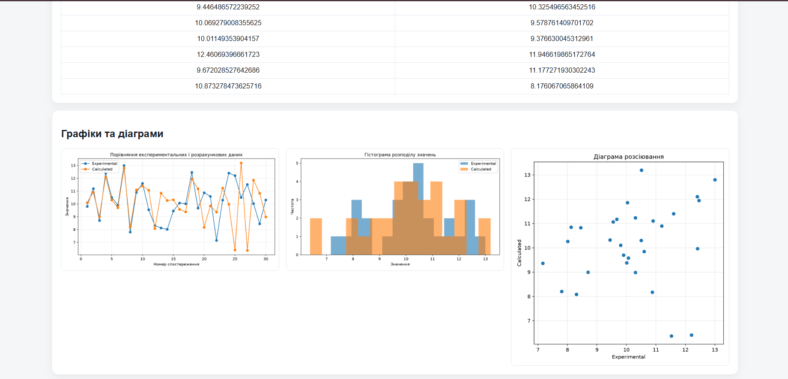

# Statistical Data Analysis & Report Generator 📊

**University Python project | Flask · Pandas · NumPy · Matplotlib · ReportLab**

A browser-based application for exploring experimental and calculated datasets, calculating descriptive statistics, visualizing results, and exporting reports.

> **Author:** Ruslana Martsynko. Independently developed as a university programming project. This is a learning project, not a production service.

## Features

- Import datasets from **CSV** and **Excel** (`.xlsx`, `.xls`).
- Enter, add, or clear pairs of experimental and calculated measurements.
- Generate synthetic observations using **normal distributions**.
- Calculate count, mean, median, sample variance, standard deviation, minimum, and maximum.
- Visualize datasets with **line plots, histograms, and a scatter plot**.
- Export processed data as **CSV** and generate a **PDF report** with summary statistics and charts.
 
## Application Preview




## Tech stack

- **Backend:** Python, Flask
- **Data processing:** Pandas, NumPy
- **Visualization:** Matplotlib
- **PDF generation:** ReportLab
- **Frontend:** HTML, CSS, Jinja templates

## Run locally

Requires **Python 3.10+** (use a recent version of Python; package versions are specified in `requirements.txt`).

```bash
python -m venv .venv
```

Activate the virtual environment:

```powershell
# Windows PowerShell
.venv\Scripts\Activate.ps1
```

Or, on macOS/Linux:

```bash
source .venv/bin/activate
```

Install dependencies and run:

```bash
pip install -r requirements.txt
python app.py
```

Open **http://127.0.0.1:5000** in a browser.

If you explicitly want local Flask debugging, set `FLASK_DEBUG=1` before running. Do not enable debug mode on a publicly exposed server.

## Example dataset

Try uploading [`sample_data.csv`](sample_data.csv):

```csv
experimental,calculated
9.8,10.1
11.2,10.9
8.7,9.0
```

The application also supports uploading Excel files with two data columns.

## Project structure

```text
app.py                # Flask routes and web application
data_model.py         # Data ingestion, storage and statistics
reporting.py          # Charts and PDF report generation
templates/index.html  # Web interface
static/style.css      # Styles
sample_data.csv       # Demo dataset
requirements.txt      # Python dependencies
README.md             # Project description
```

## Notes

This repository contains the **source files**, not cached Python bytecode or user-uploaded documents. Generated charts, runtime data, and reports are kept out of version control.

Before using this app beyond a classroom/local setting, additional work would be needed on validation, authentication, and deployment security.
